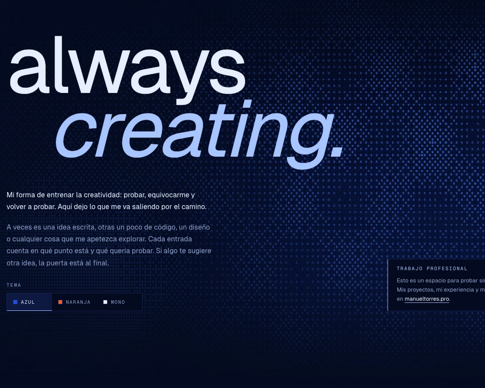

# always creating



Laboratorio personal de Manuel Torres: una forma de entrenar la creatividad. Ideas escritas, código, diseños y experimentos sin terminar, con un formulario para que la gente deje ideas o comentarios. El trabajo profesional vive aparte, en el portafolio (`lib/site.js`). La identidad visual es dither / 1-bit, con tres temas de color (azul, naranja y mono) y tipografía editorial. La web está en español; solo el nombre, always creating, va en inglés.

Rutas:

- `/`: hero con el campo dither y el selector de tema, experimentos (001) e ideas y comentarios (002).
- `/lab/<slug>`: cada experimento, con su ficha y el botón "Comentar", que abre el formulario en un overlay.
- Cualquier otra ruta: 404 propia con cabecera y pie.

## Stack

- **Framework**: Next.js 16 (App Router, JavaScript)
- **React**: 19
- **Base de datos**: MongoDB Atlas vía Mongoose
- **Estilos**: Tailwind CSS 3 con clases propias. La paleta y el dither viven en `app/globals.css`
- **Comportamiento de interfaz**: `@ui-sdk/core` y `@ui-sdk/react` (campos y selector). ui-sdk no aporta estilos: la capa visual sigue siendo nuestra
- **Correo**: Resend
- **Hosting**: Vercel

## Arranque en local

Requiere Node 22 o superior y una base MongoDB accesible.

```bash
npm install
npm run dev
```

Abre http://localhost:3000. Si el puerto está ocupado, Next muestra el que use.

Comprobaciones:

```bash
npm test
npm run build
```

`npm run build` necesita las variables de entorno cargadas. Para una compilación local sin servicios reales:

```bash
RESEND_API_KEY=re_dummy MONGODB_URI=mongodb://127.0.0.1:27017/alwayscreating npm run build
```

El repositorio no tiene linter: `next lint` desapareció en Next 16 y no hay ESLint instalado. La verificación es `npm run build` más `npm test`. Ver `AGENTS.md`.

## Variables de entorno

Crea un `.env.local` en la raíz con estas cinco variables:

```bash
MONGODB_URI=your_mongodb_connection_string
NEXT_PUBLIC_SITE_URL=http://localhost:3000
RESEND_API_KEY=your_resend_api_key
FROM_EMAIL=you@your-domain.example
NOTIFY_EMAIL=you@example.com
```

- `MONGODB_URI`: conexión a MongoDB Atlas. Sin ella la puerta no puede guardar mensajes; `lib/mongodb.js` lanza error si falta.
- `NEXT_PUBLIC_SITE_URL`: URL pública del sitio. Es la base de las URL absolutas de las metas (canonical, Open Graph, Twitter): en producción tiene que ser el dominio real, o las vistas previas en redes apuntarán a localhost. En Vercel se define en el panel.
- `RESEND_API_KEY`: clave de Resend. La usa `lib/resend.js` para construir el cliente de correo.
- `FROM_EMAIL`: remitente de los correos. Si no se define, se usa `onboarding@resend.dev`.
- `NOTIFY_EMAIL`: destino de la notificación del formulario de contacto. Si no se define, se usa `contact.manueltorres@gmail.com` (valor por defecto en `lib/resend.js`).

## Añadir un experimento

Todo vive en el repo. El registro es `lib/experiments.js`: cada entrada es una card en la portada y una página en `/lab/<slug>`.

- **Idea escrita**: añade una entrada con `kind: 'idea'` y los párrafos en `body`. No hace falta nada más.
- **Diseño**: añade una entrada con `kind: 'design'`, deja las imágenes en `public/lab/<slug>/` y lístalas en `images` como `{ src: '/lab/<slug>/archivo.png', alt: '...', caption: '...' }`. La primera imagen es la portada de la card. `body` es opcional y sale debajo de las imágenes.
- **Experimento con código**: añade una entrada con `kind: 'code'`, crea `experiments/<slug>/index.jsx` y regístralo en `lib/experiment-components.js`.
- Estados: `seed` (semilla), `running` (en marcha), `paused` (aparcado), `kept` (se queda). `question` y `learned` son opcionales y salen en la ficha.
- `npm test` comprueba que no se repiten slugs ni números y que cada experimento de código tiene su componente.

## Datos y correo

El formulario usa doble opt-in: nada te llega hasta que quien escribe confirma que el correo es suyo.

1. `POST /api/contact` valida, guarda el mensaje en MongoDB sin confirmar (con su tipo, `idea` o `comment`, y el experimento en `about` si lo hay) y envía **a quien escribe** el correo "Confirma tu mensaje", con un botón de confirmación y la copia de lo que ha mandado.
2. Al pulsar el botón, `GET /api/contact/confirm` marca el mensaje como confirmado (el enlace sirve una sola vez) y envía dos correos:
   - **A quien escribe**: "Tu idea / Tu comentario ha llegado", con la copia de su mensaje.
   - **A `NOTIFY_EMAIL`**: "Idea / Comentario de {nombre}", con nombre, correo, tipo, experimento y mensaje. Lleva `reply-to` con el correo de quien escribió, así que "Responder" le contesta directamente.
3. Después redirige a `/confirmacion`, una página del sitio que enseña el resultado (confirmado, ya usado, enlace no válido o error).

Plantillas en `lib/emails.js`, con el estilo de la web (tema azul, tablas y estilos en línea, fuentes del sistema). La franja dither de cabecera es `public/email-band.png` y se carga desde el dominio, así que en local los correos reales no la muestran.

Remitente: `FROM_EMAIL` **tiene que ser una dirección del dominio verificado en Resend** (`alwayscreating.es`), por ejemplo `always creating <hola@alwayscreating.es>`. `onboarding@resend.dev` es el remitente de pruebas de Resend y solo entrega al correo dueño de la cuenta: con él, nadie más recibe el enlace de confirmación.

Los envíos pasan por `sendEmail` (`lib/resend.js`), que comprueba el `{ error }` que devuelve Resend y lo registra en el log. La respuesta al formulario sigue siendo 201 aunque el correo falle, porque el mensaje ya está guardado.

## Assets dither

Los PNG de `public/dither/` se generan con un script del repo, no a mano y no en el navegador:

```bash
python3 tools/generate-dither.py
```

- Script: `tools/generate-dither.py`. Necesita Pillow (`python3 -m pip install pillow`).
- Salidas en `public/dither/`: `degradado-lima.png` y `grano.png`. El nombre del degradado es de cuando el acento era lima: el PNG es de dos tintas y el color lo pone `.dither-gradient` (`--fill` del tema en multiply).
- Técnica: dither ordenado con matriz Bayer 8x8 y dos tintas (`ink` y `paper`). El resultado es determinista.
- Los PNG se commitean. Solo se regeneran si cambia la matriz.

El campo dither animado del hero no es un PNG: es un canvas en `components/DitherField.jsx` que pinta la misma matriz de Bayer con el color `--dither` del tema activo y reacciona al puntero. El PNG `degradado-lima.png` se usa como respaldo estático, en las cards de experimentos y en la franja bajo el índice.

## Diseño e interfaz

- Tres temas de color (azul, naranja y mono) que se eligen en el hero y se recuerdan en el navegador. Colores en `app/globals.css`, nombres en `lib/theme.js`. Ver `DESIGN.md`.

- `components/ContactForm.jsx` usa `Field`, `FieldLabel` y `FieldError` de `@ui-sdk/react` para conectar etiqueta, error y control, y `SegmentedControl` para elegir entre idea y comentario. El experimento se elige con un `<select>` nativo.
- La cabecera se apoya sobre el campo dither del hero: sin borde inferior, sin fondo sólido y sin línea en el menú móvil. El velo superior del hero mantiene el contraste de las etiquetas.
- Antes de tocar el formulario, lee `node_modules/@ui-sdk/react/docs/llms.txt`.

## Metas e imagen para redes

- Metadatos en `app/layout.js`: título con plantilla, descripción, autor, canonical, Open Graph (`es_ES`) y tarjeta grande de Twitter/X. Cada experimento tiene los suyos en `app/lab/[slug]/page.js` (título `E/001 …`, su resumen y su canonical) y hereda la imagen.
- La imagen es `public/og-image.png` (1200x630). Se declara en `app/layout.js` con su tamaño y su texto alternativo; no se usa la convención `opengraph-image.png` de Next porque en Next 16 no aplica el `.alt.txt`.
- Sale de la captura `docs/portada.webp` pasada a dither con la matriz Bayer 8x8 del sitio. Para regenerarla (usa `sharp`, que ya viene con Next):

```bash
node tools/generate-og.mjs
```

## Deploy

El sitio vive en Vercel. Antes de desplegar, define `MONGODB_URI`, `NEXT_PUBLIC_SITE_URL`, `RESEND_API_KEY`, `FROM_EMAIL` y `NOTIFY_EMAIL` en el panel del proyecto.

La red de MongoDB Atlas debe permitir `0.0.0.0/0` en Network Access para que Vercel pueda conectar.
